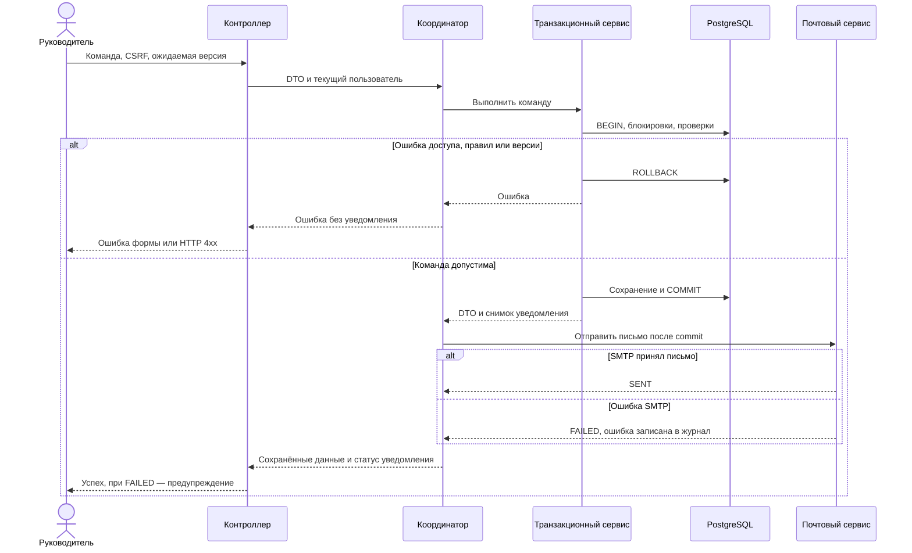

# Сохранение команды и уведомление

Координатор не удерживает транзакцию БД во время SMTP-запроса. На схеме раскрыт путь команды, требующей уведомления; остальные возвращают NOT_REQUIRED.

Снимок уведомления не содержит ленивых JPA-связей. Ошибка SMTP не откатывает commit; внезапная ошибка самого commit обрабатывается как неуспешная команда и не запускает отправку. [Подробнее об архитектуре](../architecture.md).
