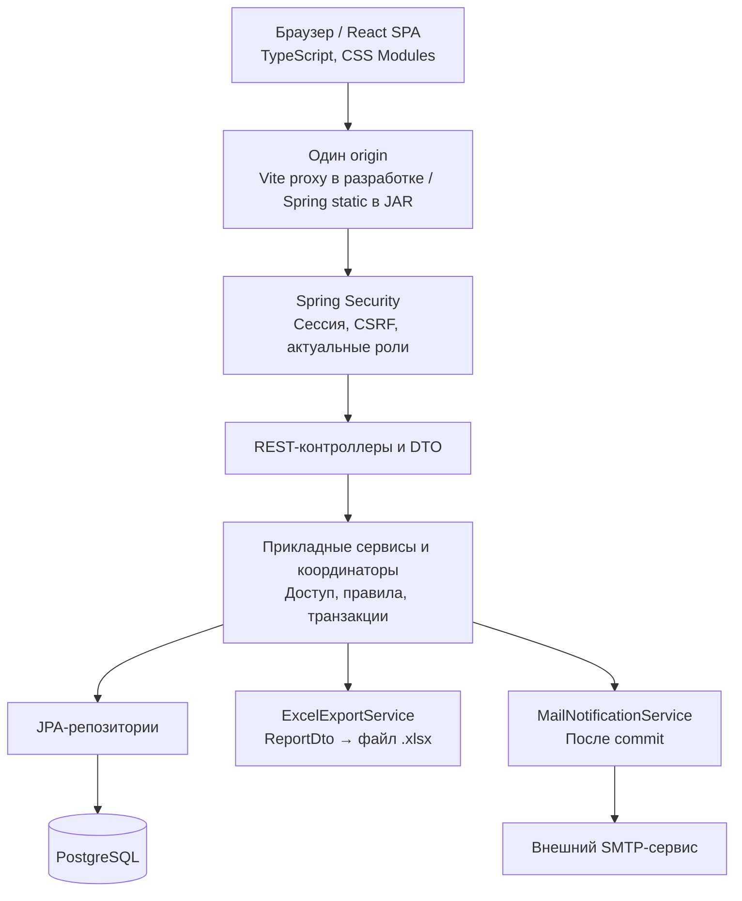

# Компоненты приложения

React отображает интерфейс и обращается к Spring API. Все проверки данных и полномочий выполняются сервером.

[Архитектура](../architecture.md) · [Контракт API](../api-contract.md) · [Экраны](../screens.md).
