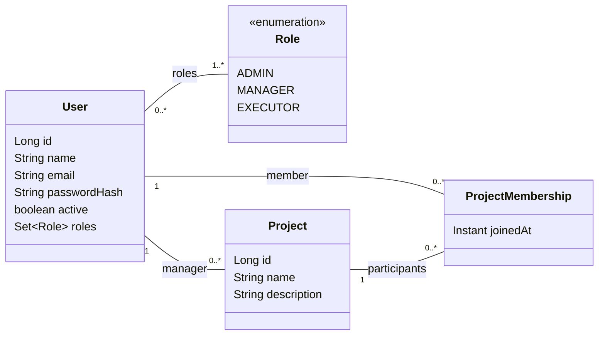

# Доменные классы: пользователи и проекты

Идентичность ProjectMembership определяется парой Project и User. Роли не образуют иерархию наследования пользователей; одна учётная запись может совмещать роли.

[Логическая модель](../data-model.md) · [Физическая модель и ограничения](../database/physical-model.md) · [DDL](../database/schema.sql).
