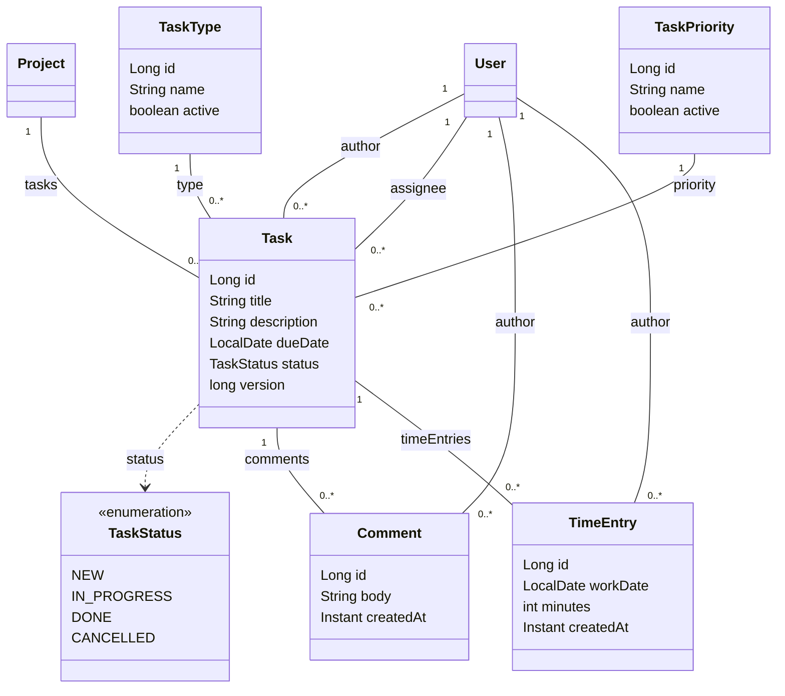

# Доменные классы: задачи и записи работы

Пользователь и проект показаны как ссылки на классы из соседнего представления. Ассоциации с авторами сохраняются при изменении assignee. Модель не задаёт окончательные JPA-аннотации.

[Логическая модель](../data-model.md) · [Физическая модель и ограничения](../database/physical-model.md) · [DDL](../database/schema.sql).
