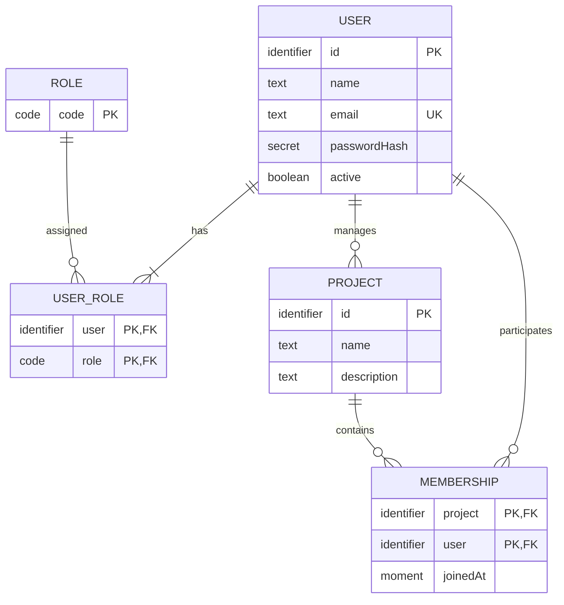

# Логическая модель: доступ и проекты

Кратность 1..* ролей — бизнес-инвариант пользователя. Его обеспечение сервисом отдельно от внешних ключей описано в физической модели.

[Логическая модель](../data-model.md) · [Физическая модель и ограничения](../database/physical-model.md) · [DDL](../database/schema.sql).
