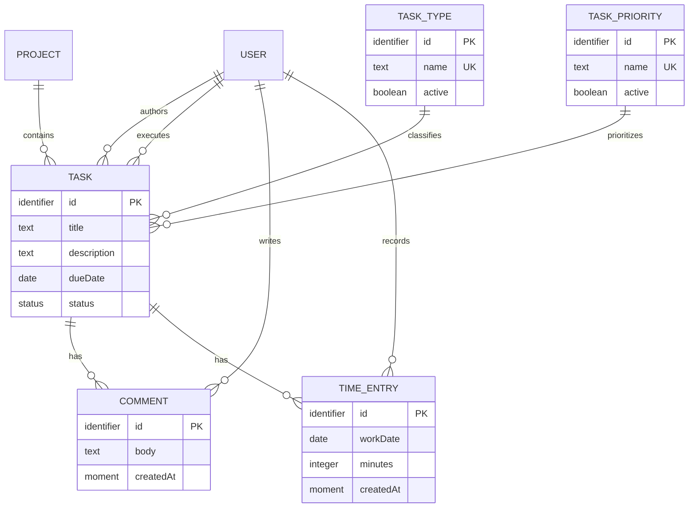

# Логическая модель: задачи и учёт работы

Каждая линия от USER к TASK обозначает отдельную обязательную связь: автора или текущего исполнителя. Пользователь и проект раскрыты в соседнем представлении доступа.

[Логическая модель](../data-model.md) · [Физическая модель и ограничения](../database/physical-model.md) · [DDL](../database/schema.sql).
