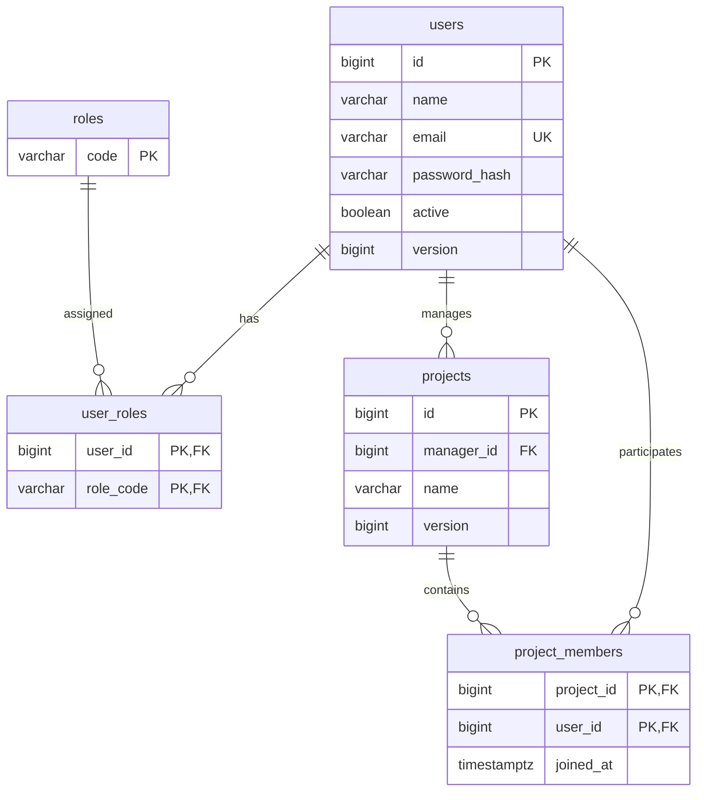

# Физическая модель: доступ и проекты

Показаны ключевые поля таблиц PostgreSQL. Кратность 0..* у user_roles отражает возможности DDL; минимум одна роль обеспечивается общей транзакцией сервиса.

[Логическая модель](../data-model.md) · [Физическая модель и ограничения](../database/physical-model.md) · [DDL](../database/schema.sql).
