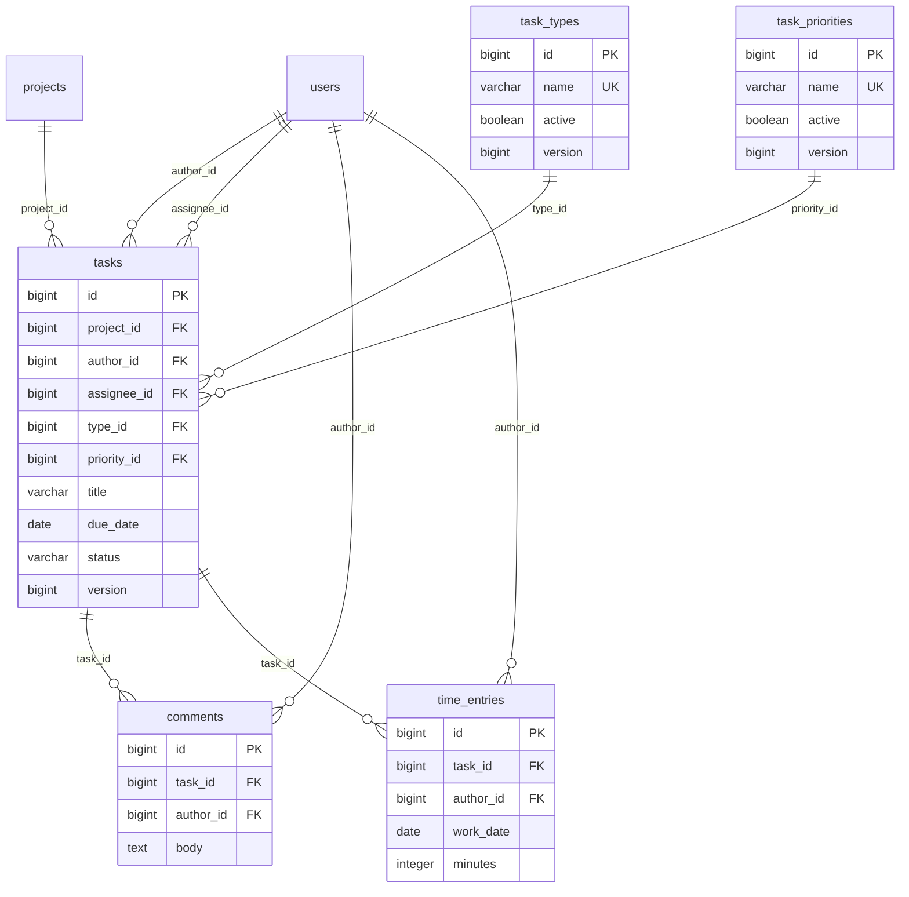

# Физическая модель: задачи и учёт работы

Показаны ключевые поля PostgreSQL. Внешние ключи исполнителя, авторов и проекта обязательны. Пользователь и проект раскрыты в соседнем представлении доступа. Отметка UK у имени справочника соответствует уникальному индексу lower(name).

[Логическая модель](../data-model.md) · [Физическая модель и ограничения](../database/physical-model.md) · [DDL](../database/schema.sql).
