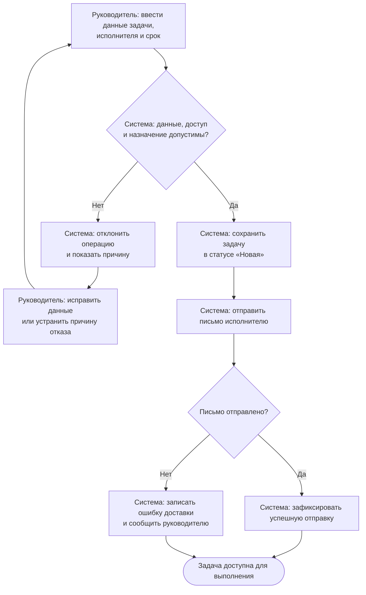

# Назначение задачи и уведомление

Предусловия: руководитель вошёл в систему, проект создан и в него включён исполнитель. Схема детализирует постановку задачи из [общего процесса](task-workflow.md).

Исполнитель должен быть активным участником проекта с ролью исполнителя. При отказе операция целиком отклоняется; повторная попытка возможна после устранения причины. Отказ от повторной попытки завершает сценарий без создания задачи.

Письмо отправляется после успешного сохранения. При ошибке доставки задача и назначение сохраняются: повторно создавать задачу не требуется. Этот же порядок обработки результата отправки используется при изменении исполнителя или срока.
