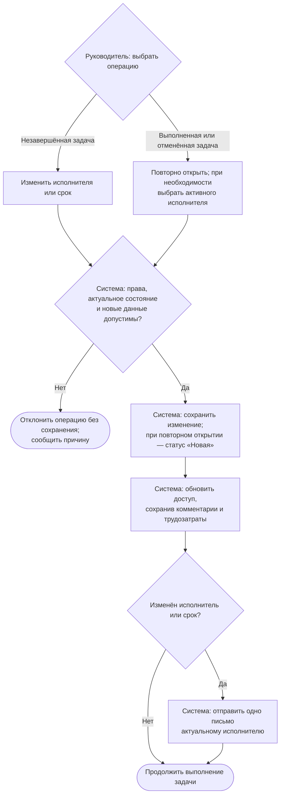

# Переназначение и повторное открытие задачи

Предусловия: руководитель вошёл в систему и имеет доступ к задаче своего проекта. Схема детализирует изменение назначения во время работы и повторное открытие из [общего процесса](task-workflow.md).

Переназначение незавершённой задачи не меняет её статус. При повторном открытии прежний исполнитель должен удовлетворять BR-02; иначе руководитель выбирает подходящего участника. Статус «Новая» и новое назначение сохраняются как единая операция. Описание, срок, тип и приоритет закрытой задачи изменяются только после повторного открытия.

При одновременной смене исполнителя и срока отправляется одно письмо новому исполнителю с итоговыми данными. Повторное открытие без смены исполнителя не вызывает письмо. Успешная отправка и ошибка доставки обрабатываются по [схеме уведомления](task-assignment.md); сбой почты не отменяет изменение.

Исторические авторы комментариев и записей времени сохраняются. При устаревшей карточке изменение отклоняется с предложением обновить данные; после устранения причины отказа операцию можно повторить.
