# Постановка, выполнение и контроль задачи

Подписи действий указывают ответственного участника: руководителя, исполнителя или систему.

```mermaid
flowchart TD
    Start([Начало]) --> CreateProject["Руководитель: создать проект и включить исполнителя"]
    CreateProject --> EnterTask["Руководитель: ввести задачу, исполнителя и срок"]
    EnterTask --> Invalid{"Система: данные или назначение некорректны?"}
    Invalid -->|Да| ShowErrors["Система: показать ошибки без сохранения"]
    ShowErrors --> Correct["Руководитель: исправить данные"]
    Correct --> Invalid
    Invalid -->|Нет| SaveTask["Система: сохранить задачу в статусе «Новая»"]
    SaveTask --> SendMail["Система: попытаться отправить письмо исполнителю"]
    SendMail --> MailSent{"Письмо отправлено?"}
    MailSent -->|Да| LogSuccess["Система: зафиксировать успешную отправку"]
    MailSent -->|Нет| LogFailure["Система: записать ошибку доставки и сообщить руководителю"]
    LogFailure --> KeepAssignment["Система: сохранить результат назначения"]
    LogSuccess --> OpenTask
    KeepAssignment --> OpenTask

    OpenTask["Исполнитель: открыть назначенную задачу"]
    OpenTask --> BeginWork["Исполнитель: перевести в работу, если задача новая"]
    BeginWork --> Work["Исполнитель: выполнять работу, добавлять комментарии и время"]
    Work --> Review["Руководитель: проверить ход выполнения"]
    Review --> Cancel{"Руководитель: задачу отменить?"}
    Cancel -->|Да| CancelTask["Руководитель: отменить задачу"]
    Cancel -->|Нет| Change{"Руководитель: сменить исполнителя или срок?"}
    Change -->|Да| Select["Руководитель: выбрать активного участника или новый срок"]
    Select --> SaveChange["Система: проверить и сохранить изменение"]
    SaveChange --> UpdateAccess["Система: обновить доступ, сохранив исходные записи"]
    UpdateAccess --> Notify["Система: попытаться отправить одно письмо актуальному исполнителю"]
    Notify --> DeliveryError{"Ошибка доставки?"}
    DeliveryError -->|Да| ReportError["Система: записать ошибку и сообщить инициатору"]
    DeliveryError -->|Нет| Finished
    ReportError --> Finished
    Change -->|Нет| Finished{"Исполнитель: работа завершена?"}
    Finished -->|Да| Complete["Исполнитель: отметить выполнение"]
    Finished -->|Нет| Unfinished
    Complete --> Unfinished
    CancelTask --> Unfinished{"Система: задача остаётся незавершённой?"}
    Unfinished -->|Да| OpenTask
    Unfinished -->|Нет| Report["Руководитель: просмотреть прогресс и отчёт"]

    Report --> Reopen{"Руководитель: нужно повторное открытие?"}
    Reopen -->|Да| CheckAssignment["Руководитель: проверить назначение, при необходимости выбрать активного участника"]
    CheckAssignment --> SaveReopen["Система: проверить и сохранить статус «Новая» и назначение"]
    SaveReopen --> ReopenMail["Система: при смене исполнителя отправить письмо с обработкой ошибки"]
    ReopenMail --> OpenTask
    Reopen -->|Нет| Export["Руководитель: при необходимости выгрузить отчёт в Excel"]
    Export --> Stop([Конец])
```

Все действия проверяются сервером по роли, объекту и текущему состоянию. При ошибке доступа или валидации операция не сохраняется. Сбой почты не отменяет сохранённые данные. Повторное открытие возвращает задачу к началу этапа выполнения.
