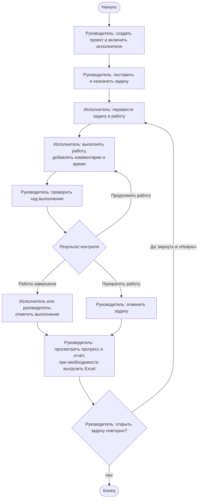

# Постановка, выполнение и контроль задачи

Общая схема показывает работу команды без технических ветвлений. Постановка задачи описана в [схеме назначения и уведомления](task-assignment.md), изменение назначения и возобновление работы — в [схеме переназначения и повторного открытия](task-reassignment.md).

Во время выполнения руководитель может изменить исполнителя или срок. Новую задачу также можно отменить до начала работы; все допустимые переходы показаны в диаграмме состояний раздела 1.4 ПЗ.

Каждая операция проверяется сервером по роли, доступу к объекту и текущему состоянию. Ошибка доступа или валидации не сохраняет изменение, сбой почты не отменяет сохранённые данные. Повторное открытие требует действующего назначения либо его одновременной корректировки.
