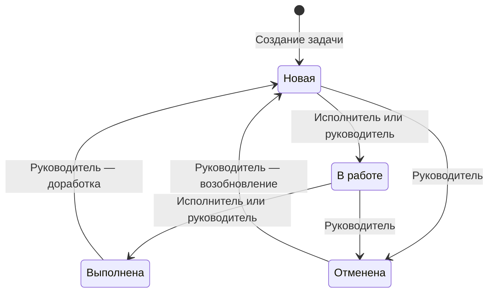

# Пояснительная записка

Курсовая работа по дисциплине «Разработка корпоративных приложений».
Тема: «Веб-приложение “Трекер задач”».

## 1. Анализ технического задания

### 1.1. Описание предметной области

#### Характеристика деятельности

В рамках курсовой работы рассматривается организация работы небольшой команды, участники которой выполняют задачи в составе нескольких проектов. Это условный контекст использования приложения: описание не опирается на обследование конкретного предприятия. Проект объединяет работы, направленные на достижение общей цели, а задача представляет отдельную работу, для которой необходимо определить ожидаемый результат, ответственного и срок выполнения.

При совместной работе участникам требуется согласованная информация о том, какие задачи запланированы, кому они поручены, на каком этапе находятся и сколько времени затрачено на их выполнение. Руководитель использует эти сведения для распределения нагрузки, выявления задержек и принятия решений о перераспределении работ. Исполнитель должен понимать содержание поручения, установленный срок и текущее состояние своих задач.

#### Участники и общий порядок работы

В предметной области выделяются три основные роли: руководитель, исполнитель и администратор. Руководитель создаёт проекты и задачи, назначает исполнителей, устанавливает сроки и контролирует ход выполнения. При изменении обстоятельств он уточняет поручения и перераспределяет задачи. Исполнитель просматривает назначенные ему задачи, выполняет работы, отражает их состояние, оставляет комментарии и фиксирует затраченное время. Администратор управляет учётными записями пользователей и настраивает справочники системы. Подробные полномочия и возможность совмещения ролей определяются при разработке матрицы прав.

Работа начинается с определения проекта и постановки задач. Для каждой задачи задаются содержание работы, исполнитель и срок. В ходе выполнения исполнитель обновляет статус, сообщает существенные сведения через комментарии и вносит записи о трудозатратах. Руководитель просматривает актуальное состояние работ, сопоставляет его со сроками и при необходимости меняет распределение задач. Накопленные данные используются для получения сводной информации о проектах и подготовки отчётов. Конкретные статусы и правила переходов между ними определяются при описании жизненного цикла задачи.

#### Проблемы учёта и контроля

В рассматриваемом сценарии без единой системы сведения о работах могут храниться в переписке, личных записях и отдельных таблицах. При таком порядке учёта договорённости приходится искать в нескольких источниках, а изменения поручений могут быть известны не всем участникам. Возникает риск неоднозначного понимания ответственности и использования устаревших сроков или состояний задачи.

Для контроля руководителю приходится отдельно запрашивать сведения у исполнителей и вручную сводить ответы. Это затрудняет своевременное обнаружение задержек и оценку состояния проекта. Если затраченное время не фиксируется вместе с задачами, его сложно сопоставить с выполненными работами. Подготовка отчёта также требует повторного сбора и проверки данных. Перечисленные проблемы характеризуют выбранный сценарий и не являются результатами измерений в реальной организации.

#### Назначение и границы автоматизации

Разрабатываемое веб-приложение предназначено для централизованного учёта проектов и задач и поддержки взаимодействия руководителя с исполнителями. Цель автоматизации — упростить планирование и контроль работ за счёт хранения сведений о задачах, ответственных, сроках, состояниях и трудозатратах в одном месте.

Система должна поддерживать управление пользователями и справочниками, создание проектов и задач, назначение и перераспределение работ, изменение состояния задач, комментирование и учёт затраченного времени. Для контроля предусматриваются сводные отчёты на основе данных базы и экспорт в Excel или PDF. Для информирования пользователей предусматриваются уведомления по электронной почте; события их отправки определяются при формализации требований. Доступ к операциям и данным должен зависеть от полномочий пользователя.

Границы курсового проекта охватывают учёт и контроль задач внутри одной организации. В обязательную версию не включаются расчёт заработной платы, кадровый и бухгалтерский учёт, встроенный чат, вложенные задачи, управление спринтами, сложные зависимости между работами и интеграции с системами разработки. Фиксация трудозатрат служит анализу выполнения задач и не рассматривается как табельный учёт рабочего времени. Выбор исполнителя, оценка результата и организационные решения остаются ответственностью участников процесса.

#### Основные понятия

| Понятие | Определение |
| --- | --- |
| Пользователь | Участник, имеющий учётную запись и доступ к разрешённым операциям системы. |
| Роль | Набор полномочий, соответствующий функциям пользователя в системе. |
| Проект | Совокупность задач, объединённых общей целью. |
| Участие в проекте | Принадлежность пользователя к составу участников конкретного проекта. |
| Задача | Отдельная работа в рамках проекта с описанием ожидаемого результата, ответственным и сроком. |
| Исполнитель задачи | Пользователь, которому поручено выполнение задачи. |
| Срок выполнения | Установленная дата, к которой требуется выполнить задачу. |
| Статус задачи | Обозначение текущего этапа её выполнения. |
| Комментарий | Сообщение пользователя, относящееся к конкретной задаче. |
| Запись о трудозатратах | Сведения о времени, затраченном пользователем на работу над задачей. |
| Справочник | Управляемый набор значений, используемых при работе с данными системы; состав справочников определяется в требованиях. |

Ожидаемый результат внедрения — единый источник актуальных сведений о работе команды. Исполнители получают доступ к своим поручениям и средствам фиксации хода работы, а руководитель — к данным для контроля сроков, распределения задач и подготовки отчётов. Достижение этого результата проверяется по функциональным требованиям и сценариям использования, которые разрабатываются на следующих этапах.

### 1.2. Заинтересованные стороны, роли и права доступа

#### Заинтересованные стороны

Заинтересованные стороны определяют ожидания от системы. Пользовательская роль задаёт полномочия при работе с приложением. Эти понятия различаются: заинтересованная сторона может не иметь собственной учётной записи или отдельной роли.

| Заинтересованная сторона | Интерес и ожидаемый результат | Влияние на требования |
| --- | --- | --- |
| Руководитель проекта | Понимать состояние работ, распределять ответственность и замечать задержки. | Управление проектами, участниками, задачами и сроками; контроль прогресса и сводные отчёты. |
| Исполнитель | Получать понятные поручения и отражать ход своей работы. | Просмотр назначенных задач, изменение статуса, комментарии, учёт времени и уведомления. |
| Администратор | Поддерживать доступ пользователей и согласованные значения справочников. | Создание и блокировка учётных записей, назначение ролей, настройка справочников. |
| Владелец команды / заказчик | Получать прозрачную картину выполнения проектов. | Достоверность сводных данных и возможность выгрузить отчёт; отдельная роль в обязательной версии не вводится. |
| Разработчик и сопровождающий | Иметь понятные правила, проверяемую реализацию и воспроизводимый запуск. | Документированные ограничения доступа, валидация, тесты и инструкция запуска. |

В приложении используются три роли: администратор, руководитель и исполнитель. Заказчик и разработчик не получают дополнительных прав только на основании своего статуса заинтересованной стороны.

#### Совмещение ролей руководителя и исполнителя

Пользователю разрешается совмещать роли руководителя и исполнителя, поскольку в небольшой команде руководитель может самостоятельно выполнять часть задач. Это позволяет ему управлять проектом и учитывать собственную работу в одной учётной записи. При совмещении сохраняются ограничения доступа: управлять можно только своими проектами, а действия исполнителя доступны для назначенных ему задач.

#### Области доступа и участие в проектах

Для обязательной версии у проекта предусматривается один руководитель — пользователь, создавший проект. Под «своим проектом» в матрице понимается проект, которым пользователь руководит, а под «своей задачей» — задача, текущим исполнителем которой он назначен. Роль руководителя сама по себе не открывает доступ к проектам других руководителей.

Руководитель добавляет и исключает исполнителей из состава участников своего проекта. Назначить задачу можно только активному пользователю с ролью исполнителя, включённому в этот проект. Руководитель с дополнительной ролью исполнителя может включить себя в состав участников и назначить задачу себе. Участие в проекте не даёт исполнителю права просматривать чужие задачи.

Исполнитель видит название и описание проекта, в котором участвует, и назначенные ему задачи вместе с их комментариями и записями времени. Сводные сведения обо всех задачах проекта доступны руководителю. Для выбора участников руководителю доступен минимальный список активных исполнителей — имя и идентификатор; управление их учётными записями ему не предоставляется.

Исключение участника из проекта допускается после переназначения его незавершённых задач. Блокировка пользователя запрещает вход и новые назначения, но не удаляет созданные им данные. После переназначения задачи прежний исполнитель теряет доступ к ней, если не имеет доступа как руководитель проекта; его комментарии и записи времени сохраняются для руководителя и нового исполнителя. Порядок работы с историческими записями определяется бизнес-правилами в реестре требований.

#### Матрица прав

В таблице права указаны для каждой роли отдельно. При совмещении пользователь получает разрешения своих ролей с сохранением ограничений по конкретному объекту. «Нет» означает отсутствие разрешения от данной роли.

| Операция | Администратор | Руководитель | Исполнитель |
| --- | --- | --- | --- |
| Создать пользователя, изменить его данные, назначить роли, заблокировать учётную запись | Да, для пользователей системы | Нет | Нет |
| Настроить справочники | Да | Нет | Нет |
| Просмотреть значения справочников для доступных операций | Да | Да | Да |
| Создать проект | Нет | Да; становится его руководителем | Нет |
| Просмотреть сведения о проекте | Нет | Свои проекты | Проекты, в которых участвует |
| Изменить сведения о проекте | Нет | Свои проекты | Нет |
| Просмотреть список активных исполнителей для назначения | Нет | Да, минимальные данные | Нет |
| Управлять составом участников проекта | Нет | Свои проекты | Нет |
| Создать задачу, изменить описание, срок и приоритет | Нет | В своих проектах | Нет |
| Назначить или сменить исполнителя задачи | Нет | В своих проектах; из участников проекта | Нет |
| Просмотреть задачи и их подробности | Нет | Все задачи своих проектов | Только назначенные ему задачи |
| Изменить статус задачи | Нет | В своих проектах, по правилам жизненного цикла | В назначенных ему задачах, по правилам жизненного цикла |
| Просмотреть комментарии и записи времени | Нет | В задачах своих проектов | В назначенных ему задачах |
| Добавить комментарий | Нет | В задачах своих проектов | В назначенных ему задачах |
| Внести собственные трудозатраты | Нет | Только при дополнительной роли исполнителя и назначении задачи себе | В назначенных ему задачах |
| Просмотреть прогресс, сформировать и выгрузить сводный отчёт | Нет | По своим проектам | Нет |

Административная роль не предоставляет доступ к содержимому проектов, задач и отчётов. Администратор может выполнять работу с проектами только при назначении ему соответствующей роли и наличии доступа к конкретному объекту. Удаление объектов, исправление комментариев и записей времени ограничены реестром требований. Допустимые переходы статусов определены в разделе 1.4; эта матрица не предоставляет на них неявных разрешений.

#### Проверка полномочий

Полномочия проверяются сервером при каждом обращении к защищённой операции, включая получение данных и экспорт отчётов. Скрытие элемента интерфейса не заменяет проверку доступа. При обращении по прямому адресу или подмене идентификатора действуют те же ограничения, что и при работе через интерфейс.

Например, руководитель одного проекта не может изменить срок задачи из чужого проекта; исполнитель не может открыть чужую задачу, даже если состоит с её исполнителем в одном проекте; администратор без дополнительных ролей не может получить отчёт по проекту. Руководитель с ролью исполнителя может внести время в задачу, назначенную ему, но не от имени другого участника.

### 1.3. Требования к системе

На основе задания и анализа предметной области составлен [реестр требований и критериев приёмки](requirements.md). Функциональные требования FR-01–FR-16 определяют работу с пользователями, справочниками, проектами и задачами, контроль прогресса, отчётность, экспорт и email-уведомления. Бизнес-правила BR-01–BR-12 уточняют доступ, назначение исполнителей, учёт времени, расчёт показателей и изменение состояния задач. Нефункциональные требования NFR-01–NFR-09 задают условия адаптивности, валидации, безопасности, хранения данных, архитектуры, тестирования и документирования.

Для каждого требования определён проверяемый результат. Реестр отделяет обязательные функции задания от рабочих проектных решений и содержит таблицу покрытия. Переходы статусов определены в разделе 1.4; модели и архитектурные решения будут описаны на соответствующих этапах проектирования. Фактическое выполнение требований подтверждается после реализации и проверки системы.

### 1.4. Бизнес-процессы и жизненный цикл задачи

#### Процесс без автоматизации и с приложением

Рассматривается условная команда из раздела 1.1. В исходном сценарии руководитель передаёт поручения через переписку или устно, исполнители ведут собственные записи, а сведения о результатах и времени собираются отдельно. Для изменения ответственного и подготовки сводки требуется повторно согласовать и сопоставить информацию. Это модель исходного процесса, а не результат обследования предприятия.

С приложением поручение регистрируется как задача конкретного проекта. Назначение, срок, статус, комментарии и трудозатраты доступны в одной карточке с учётом прав пользователя. Руководитель контролирует работы по сохранённым данным, а отчёт строится на их основе. Приложение проверяет допустимость действий; решение о распределении работ и оценка результата остаются за участниками.

#### Описание процессов

Общее предусловие — пользователь вошёл в систему, его запись активна и у него есть доступ к объекту. При ошибке ввода или нарушении правил изменение не сохраняется. Сбой почты после сохранения обрабатывается отдельно и не отменяет основную операцию.

| Процесс и требования | Участники и входные данные | Последовательность | Результат | Ограничения и исключения |
| --- | --- | --- | --- | --- |
| Создание проекта и состава участников — FR-04, FR-05 | Руководитель; название, описание проекта, выбранные пользователи. | Руководитель создаёт проект и добавляет активных исполнителей; система проверяет роли и отсутствие повторного участия. | Проект связан с руководителем, состав участников сохранён. | Пустое название, неактивный пользователь и отсутствие роли исполнителя отклоняются. Исключение участника с незавершёнными задачами требует предварительного переназначения. |
| Постановка и назначение задачи — FR-06, FR-07, FR-15, FR-16 | Руководитель; проект, название, описание, исполнитель, срок, тип и приоритет. | Руководитель заполняет задачу; система проверяет доступ, участника и справочники, сохраняет задачу со статусом «Новая», затем отправляет письмо исполнителю. | Задача видна руководителю и исполнителю; при доступной почте доставлено уведомление. | Пользователь вне проекта, блокировка исполнителя и некорректные поля не допускают сохранения. При сбое SMTP задача сохраняется, инициатор получает сообщение о проблеме уведомления. |
| Выполнение, комментарии и время — FR-08–FR-11 | Исполнитель; назначенная задача, новый статус, текст комментария или дата и минуты работы. Руководитель может менять статус и комментировать. | Пользователь открывает задачу, начинает работу, добавляет сведения о ходе выполнения; исполнитель вносит свои трудозатраты и отмечает выполнение. Каждое действие проверяется и сохраняется отдельно. | Карточка отражает состояние и накопленные записи с авторами; сумма времени пересчитана. | Комментарии и время добавляются только в «Новой» и «В работе». Неположительное время, будущая дата, подмена автора и запрещённый переход отклоняются. Руководитель учитывает своё время только как назначенный исполнитель. |
| Перераспределение и изменение срока — FR-06, FR-07, FR-15 | Руководитель; незавершённая задача, новый исполнитель или срок. | Руководитель выбирает участника или меняет срок; система сохраняет новые значения, обновляет доступ и отправляет письмо актуальному исполнителю. | Ответственный и срок актуальны; исходные комментарии и трудозатраты сохранены. | Новый исполнитель должен быть активным участником. Переназначение не меняет статус. Для выполненной или отменённой задачи сначала требуется повторное открытие. При одновременной смене срока и исполнителя отправляется одно письмо с итоговыми данными новому исполнителю. |
| Завершение, отмена и повторное открытие — FR-09 | Исполнитель или руководитель; текущая задача и целевое состояние. | Система проверяет переход по таблице ниже и права инициатора, затем сохраняет статус и обновляет показатели проекта. | Задача завершена, отменена либо возвращена в работу; данные не удалены. | Исполнитель не отменяет и не открывает повторно задачи. Руководитель повторно открывает задачу только при действующем назначении активному участнику либо одновременно назначает подходящего исполнителя. |
| Контроль и отчётность — FR-12–FR-14 | Руководитель; выбранный свой проект, при просмотре задач — фильтры. | Руководитель изучает задачи и просрочку, получает сводку; система вычисляет показатели из БД и по запросу формирует Excel-файл. | На экране и в выгрузке доступны показатели проекта, распределение задач и трудозатрат. | Чужой проект недоступен, в том числе по прямому адресу экспорта. Для проекта без задач выводятся нули. Отменённые задачи исключаются из знаменателя прогресса, но их трудозатраты остаются в отчёте. |
| Администрирование — FR-02, FR-03 | Администратор; данные пользователя, роли либо значение справочника. | Администратор создаёт или изменяет запись, блокирует пользователя, добавляет или деактивирует значение справочника; система проверяет ограничения. | Учётные записи и справочники обновлены без удаления связанных данных. | Нельзя отозвать роль исполнителя при незавершённых задачах и роль руководителя при наличии его проектов. Дубликаты отклоняются. Блокировка прекращает доступ, но сохраняет задачи и записи. |

Диаграммы в Mermaid разделены по уровню детализации: [общий процесс](diagrams/task-workflow.md) показывает постановку, выполнение и контроль задачи; [назначение и уведомление](diagrams/task-assignment.md) — проверку данных и обработку результата отправки письма; [переназначение и повторное открытие](diagrams/task-reassignment.md) — изменение исполнителя, срока и возврат закрытой задачи в работу. Допустимые переходы статусов приведены отдельно ниже.

#### Состояния задачи

| Статус | Смысл |
| --- | --- |
| Новая | Задача поставлена и назначена, выполнение ещё не начато. |
| В работе | Выполнение начато, работа ещё не завершена. |
| Выполнена | Работа отмечена как выполненная. Отдельного этапа приёмки в обязательной версии нет. |
| Отменена | Руководитель прекратил выполнение задачи; её данные сохраняются. |

Термин «незавершённая задача» означает статус «Новая» или «В работе». Выполненная и отменённая задачи закрыты для изменения описания, срока, типа, приоритета, исполнителя и добавления комментариев или времени. Они остаются доступными для чтения по матрице прав. Повторное открытие — отдельная разрешённая операция, после которой данные вновь можно изменять.

#### Допустимые переходы

| Исходный статус | Новый статус | Кто выполняет | Условия |
| --- | --- | --- | --- |
| Новая | В работе | Назначенный исполнитель или руководитель проекта | Исполнитель задачи активен, имеет нужную роль и участвует в проекте. |
| В работе | Выполнена | Назначенный исполнитель или руководитель проекта | Работа завершена; наличие записей времени не является обязательным условием. |
| Новая | Отменена | Руководитель проекта | Поручение утратило актуальность или было создано ошибочно. |
| В работе | Отменена | Руководитель проекта | Дальнейшее выполнение прекращено. |
| Выполнена | Новая | Руководитель проекта | Требуется доработка; назначение удовлетворяет BR-02 или корректируется в той же операции. |
| Отменена | Новая | Руководитель проекта | Работу возобновляют; назначение удовлетворяет BR-02 или корректируется в той же операции. |

Все остальные переходы запрещены. В частности, нельзя завершить новую задачу без перевода в работу, вернуть «В работе» в «Новую» или отменить выполненную задачу напрямую. Запрос текущего статуса не меняет данные. Проверка прав и текущего состояния выполняется сервером перед сохранением; статус из устаревшей карточки не должен перезаписать уже изменённое состояние.

Четырёх состояний достаточно для постановки, выполнения, завершения и отмены работы. Право исполнителя отмечать выполнение позволяет обновлять состояние без обязательного подтверждения руководителя; при необходимости руководитель возвращает задачу на доработку. Повторное открытие возвращает её в «Новую», поскольку новое начало работы должно быть отмечено явно. Оно не удаляет прежние комментарии и трудозатраты и изменяет прогресс проекта по общей формуле.

#### Контрольные сценарии процесса

1. Руководитель создаёт проект, включает исполнителя и назначает задачу. Исполнитель переводит её в работу, добавляет комментарий и 30 и 45 минут работы, завершает задачу. Руководитель видит 75 минут в отчёте и Excel-файле.
2. Руководитель переназначает задачу в работе другому участнику. Статус и исходные записи сохраняются; прежний исполнитель без иных полномочий теряет доступ, новый получает задачу и письмо.
3. Исполнитель пытается отменить задачу или открыть выполненную повторно: операция отклоняется. Руководитель повторно открывает её, после чего исполнитель снова может начать работу.
4. У закрытой задачи заблокирован исполнитель. Повторное открытие без корректировки назначения отклоняется; с одновременным назначением активного участника сохраняется как единая операция и вызывает письмо новому исполнителю.
5. Во время назначения недоступен SMTP. Задача сохраняется, ошибка доставки фиксируется, руководителю показано сообщение; повторно создавать задачу для исправления доставки не требуется.
6. Пользователь отправляет изменение из устаревшей карточки, если статус уже изменён другим участником. Операция отклоняется с предложением обновить карточку; актуальное состояние сохраняется.

### 1.5. Варианты использования системы

Варианты использования описывают цели участников и ожидаемое взаимодействие с приложением. Пользовательские участники — администратор, руководитель и исполнитель; внешний почтовый сервис участвует в отправке уведомлений. Граница системы охватывает интерфейс, проверки, бизнес-операции, хранение данных и подготовку отчётов.

Для читаемости модель разделена на три диаграммы Mermaid: [вход и администрирование](diagrams/use-cases-administration.md), [управление проектами и задачами](diagrams/use-cases-management.md), [работа исполнителя](diagrams/use-cases-execution.md). Это представления одной системы с общими идентификаторами вариантов использования, а не отдельные приложения. Ограничения по ролям и объектам сохраняются по разделу 1.2; переходы статусов — по разделу 1.4.

В [реестре вариантов использования](use-cases.md) описаны UC-01–UC-14: участники, предусловия, основной ход, альтернативы, ошибки и постусловия. Таблица покрытия связывает сценарии со всеми функциональными требованиями FR-01–FR-16. Общие отказы доступа и проверки актуальности данных применяются ко всем защищённым операциям.

Вход является предусловием защищённых действий. Отправка уведомления следует за успешным сохранением назначения или изменения срока; её отказ не отменяет основную операцию.

## 2. Разработка моделей данных

### 2.1. Сущности и логическая модель

На основе требований и вариантов использования выделены пользователь, роль, назначение роли, проект, участие в проекте, задача, тип, приоритет, комментарий и запись времени. Пользователь совмещает роли через отдельную связь; руководитель проекта и его исполнители представлены независимыми отношениями. У задачи один проект, один автор и один текущий исполнитель.

[Логическая модель](data-model.md) определяет атрибуты, ключи, кардинальности и обязательность связей. Для читаемости диаграммы разделены на [доступ и проекты](diagrams/logical-access.md) и [задачи и учёт](diagrams/logical-tasks.md). Модель организована в третьей нормальной форме: данные пользователя, проекта и справочников не дублируются в задачах; проект комментария и записи времени определяется через задачу.

### 2.2. Назначение исполнителя и сохранение истории

Задача ссылается на пользователя напрямую. Действующее участие и роль проверяются при назначении, начале работы и повторном открытии по BR-02. Связь задачи с записью текущего участия не вводится, поскольку исключение пользователя после закрытия не должно уничтожать историческое назначение. Для незавершённых задач исключение допускается только после переназначения.

Комментарии и трудозатраты имеют собственных авторов. Изменение текущего исполнителя не меняет авторство сохранённых записей. Блокировка пользователя, отмена задачи и деактивация справочника сохраняют связанные данные.

### 2.3. Физическая модель и целостность

Для хранения выбрана PostgreSQL 16. [Физическая модель](database/physical-model.md) содержит десять таблиц, типы и длины полей, ключи, ограничения, индексы и правила удаления. Проект [SQL-схемы](database/schema.sql) предназначен для переноса в начальную миграцию приложения. Диаграммы отдельно показывают [доступ и проекты](diagrams/physical-access.md) и [задачи и учёт](diagrams/physical-tasks.md).

База обеспечивает обязательность ссылок, отсутствие дубликатов, допустимый набор статусов и положительные минуты. Проверка ролей, активности, участия, переходов статусов, будущей даты работы и доступности объекта выполняется сервисом в транзакции. Версия изменяемой карточки позволяет обнаружить конфликт параллельных изменений; поля версии сами по себе не заменяют проверки и блокировки в приложении. Эти обязанности разграничены в физической модели.

### 2.4. Доменные классы

UML-модель разделена на [пользователей и проекты](diagrams/domain-access.md) и [задачи и записи работы](diagrams/domain-tasks.md). Роль и статус представлены перечислениями, участие — отдельным классом. Классы описывают доменные понятия и связи; они не заменяют ER-модели и не являются готовой реализацией JPA-сущностей.

### 2.5. Поддержка отчётов, уведомлений и сценариев

Прогресс, просрочка и сводные показатели вычисляются по сохранённым задачам и записям времени. Количество задач группируется по текущему исполнителю, минуты — по автору записи; время отменённых задач остаётся в отчёте. Суммы агрегируются отдельно от комментариев, чтобы соединения не размножали строки. Согласованный снимок данных обеспечивает внутреннюю непротиворечивость одного отчёта или файла Excel.

Отдельные таблицы отчётов и уведомлений в обязательную версию не вводятся: отчёт строится по запросу, письмо формируется после успешного сохранения, результат отправки фиксируется в журнале приложения. Ошибка SMTP не отменяет основные данные. Соответствие модели FR-01–FR-16 и UC-01–UC-14 приведено в таблице покрытия логической модели.

## 3. Проектирование архитектуры системы

### 3.1. Стек и структура приложения

Выбрано разделение интерфейса и серверной логики: React + TypeScript + Vite для SPA; Java 21, Spring Boot 4.1.2, Gradle Wrapper 9.9.1, Spring MVC (REST), Spring Data JPA, Spring Security и PostgreSQL 16 для backend. Код хранится в одном репозитории, интерфейс — в frontend/. Для поставки его статическая сборка включается в JAR. Схема управляется Flyway; Hibernate проверяет её соответствие сущностям. Excel формируется Apache POI 6.0.0, письма отправляются JavaMailSender. Выбор версий и их официальные источники приведены в [архитектурном документе](architecture.md).

[Диаграмма компонентов](diagrams/architecture-components.md) показывает React-клиент, REST-контроллеры, прикладные сервисы, репозитории, БД и почтовый сервис. Зависимости передаются через конструкторы. Команды и представления используют DTO; JPA-сущности не передаются клиенту. Open Session in View отключён, данные для представлений подготавливаются внутри сервисной транзакции.

### 3.2. Безопасность и доступ

Аутентификация использует email, хеш пароля и серверную HTTP-сессию. На каждом защищённом запросе повторно проверяются активность и актуальные роли. После блокировки открытая сессия не позволяет продолжать работу. CSRF-защита действует на вход, выход и изменяющие запросы API; React получает токен через /api/csrf и передаёт в заголовке. Проверка роли маршрута дополняется проверкой конкретного проекта или задачи внутри сервиса.

Администратор управляет пользователями и справочниками, но без дополнительных ролей не получает содержимое проектов. Руководитель работает со своими проектами, исполнитель — с назначенными задачами. Списки и экспорт ограничиваются той же областью доступа. Политика сессии, паролей и отказов подробно определена в архитектуре.

### 3.3. Интерфейс и HTTP API

[Перечень экранов](screens.md) определяет страницы трёх ролей, формы, фильтры, повторное открытие, отчёт и адаптивность на ширинах 375 и 1440 CSS-пикселей. [Контракт API](api-contract.md) задаёт маршруты, входные и выходные DTO, версии карточек, пагинацию, успешные ответы и единый формат ошибок. React отображает результаты и ошибки API; бизнес-логика и проверка прав выполняются сервисами Spring.

### 3.4. Транзакции и одновременные изменения

Команда сохраняется целиком в транзакции. Ожидаемая версия карточки сравнивается с актуальной; устаревшее изменение отклоняется. Добавление комментария и времени одновременно проверяет состояние родительской задачи и увеличивает её версию. Общая дисциплина блокировок пользователей, справочников, проектов и задач согласует назначение с отзывом роли, исключением участника и деактивацией значения. Эти механизмы подлежат конкурентным интеграционным проверкам.

### 3.5. Отчёты и уведомления

Отчёт строится из согласованного снимка данных в транзакции REPEATABLE_READ. Задачи и минуты агрегируются отдельно, затем формируется ReportDto для экрана и экспорта .xlsx. Автор времени сохраняется независимо от текущего исполнителя.

[Последовательность команды и уведомления](diagrams/architecture-command.md) отделяет commit бизнес-данных от SMTP-запроса. Нетранзакционный координатор получает сохранённый результат и снимок письма, выполняет отправку с таймаутами и возвращает её статус. Отказ почты не превращает сохранённую операцию в неуспешную: пользователь получает предупреждение, автоматического повтора нет.

### 3.6. Конфигурация и проверка проектных решений

Параметры БД, SMTP, часовой зоны, адреса приложения и первоначального администратора передаются внешней конфигурацией. Подключения миграции и приложения имеют разные права. В Git сохраняются wrapper и миграции, секреты и данные БД исключаются. Начальный администратор создаётся явно включаемой идемпотентной процедурой без пароля по умолчанию.

Архитектурный документ содержит перечень проверок бизнес-правил, доступа, конкурентности, отчёта и почты.

## 4. Разработка и реализация системы

### 4.1. Доступ к данным

Сущности JPA отображают пользователей, роли, проекты, участие, справочники, задачи, комментарии и записи времени на схему PostgreSQL. Назначения ролей хранятся через связь многие-ко-многим, участие имеет составной ключ. Общие базовые классы задают генерируемый идентификатор, версию изменяемой записи и время создания. Связи с авторами и исполнителями независимы, каскадное удаление истории не используется. Репозитории размещены в пакетах соответствующих функций; контроллеры возвращают DTO.

### 4.2. Вход, роли и начальная учётная запись

DatabaseUserDetailsService загружает пользователя и роли из БД по нормализованному email. Spring Security проверяет пароль через DelegatingPasswordEncoder; сессия хранит стабильный идентификатор пользователя. CurrentUserFilter при каждом запросе повторно загружает активность и роли: блокировка завершает сессию, изменение ролей обновляет права. CSRF-защита действует на вход, выход и команды API.

Первый администратор создаётся BootstrapAdminService по явно включённым параметрам внешней конфигурации. Транзакционная advisory-блокировка защищает проверку существования администратора от параллельных запусков. Существующие записи и пароли не перезаписываются. Порядок настройки описан в [инструкции подготовки окружения](../SETUP.md#4-создание-начального-администратора).

GET /api/me возвращает идентификатор, имя, email и роли без хеша пароля. GET /api/csrf выдаёт токен для текущей сессии с запретом кэширования. Фильтры безопасности возвращают согласованные JSON-ошибки для API. Подробный контракт приведён в [описании API](api-contract.md).

### 4.3. Интерфейс React и сессионный API

React-клиент размещается в frontend/, использует TypeScript для DTO и CSS Modules для оформления. В разработке Vite проксирует /api на Spring Boot; в поставке статическая сборка обслуживается тем же сервером, что API. Поэтому сессионная cookie и CSRF работают без токенов авторизации в localStorage и без широкого разрешения CORS.

Вход выполняется POST /api/session с email и паролем; успешный ответ — 204, отказ — безопасная JSON-ошибка 401. После входа клиент обновляет CSRF и запрашивает /api/me. Выход через POST /api/session/logout завершает сессию. Серверные шаблоны и отдельные контроллеры HTML-форм не используются.

UserAdministrationService обслуживает создание, чтение и изменение пользователей. Команды повторно проверяют активность и роль администратора, ожидаемую версию карточки и запреты отзыва ролей при связанных проектах или незавершённых задачах. Изменение данных и user_roles выполняется атомарно с однократным увеличением версии; пароль при редактировании не меняется. DTO не содержат password_hash. Автономные проверки охватывают валидацию, правила и HTTP-ошибки; проверки транзакций PostgreSQL выделяются в интеграционные тесты.
